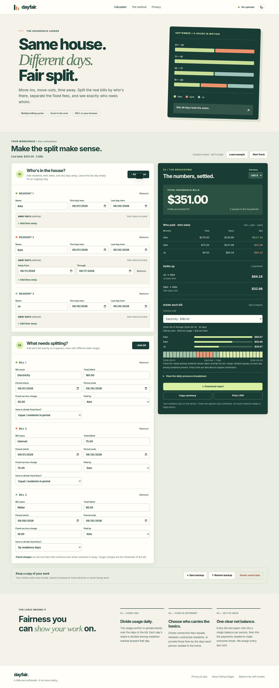
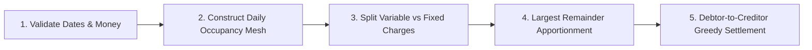

<div align="center">

# dayfair.

**Every day counted. Every cent accounted for.**

An explainable, zero-dependency, local-first utility bill splitter for changing households.  
Handles mid-cycle move-ins, move-outs, vacations, dual-tier fixed service fees, and multi-payer settlements.

[](https://github.com/rkohnmn/dayfair/actions/workflows/pages.yml)
[](https://rkohnmn.github.io/dayfair/)
[-success)](package.json)
[](privacy.html)
[](LICENSE)
[](tests/)

---

### [🚀 Open Live Calculator](https://rkohnmn.github.io/dayfair/) &nbsp;•&nbsp; [✨ Features](#-key-features) &nbsp;•&nbsp; [📐 How the Math Works](#-the-math--mechanics) &nbsp;•&nbsp; [📊 Worked Example](#-worked-example-three-roommates-three-bills) &nbsp;•&nbsp; [🔒 Privacy](#-trust-privacy--data-ownership) &nbsp;•&nbsp; [🛠️ Development](#-local-development--testing)

---

</div>

<br>

<div align="center">
  
  <p><em>Desktop reconciliation view: live date updates, per-day occupancy timeline, and minimum-transfer settlement.</em></p>
  <p><a href="docs/screenshot-mobile.png">📱 View Mobile Layout (390px responsive)</a></p>
</div>

<br>

## 💡 The Problem Dayfair Solves

When roommates live together, real life rarely follows clean calendar boundaries:
- One roommate departs on September 15th, while another moves in on September 16th.
- Someone travels for a week during the peak summer cooling bill.
- The electric bill, internet bill, and water bill all have **different billing dates**, and **different people paid them**.
- Electric companies charge a **fixed grid service fee** ($20–$40/mo) regardless of electricity consumption, plus a **variable usage fee** based on kWh.

General expense splitters (like Splitwise or Spliit) assume equal division or flat percentages across the whole billing cycle. Spreadsheets quickly become fragile mazes of nested `VLOOKUP` and date arithmetic formulas.

**Dayfair solves this with exact, day-by-day discrete occupancy modelling.** It separates fixed costs from usage, computes who was in the house each individual calendar day, divides that day's usage only among present residents, accounts for who paid what, and produces an **auditable, zero-sum settlement statement down to the exact cent**.

---

## ⚡ Comparison: Flat Splitting vs. Dayfair

| Scenario | Naive Flat Division | Simple Person-Day Ratio | Dayfair Daily Occupancy Model |
| :--- | :--- | :--- | :--- |
| **Mid-cycle Move In** | New roommate pays for days before their lease began. | Under-charges periods where fewer people lived in the home. | **Exact:** Each day is priced based on the people present on that day. |
| **Away on Vacation** | Absent roommate pays full usage for electricity they didn't consume. | Often ignores that fixed base fees still apply to contracted tenants. | **Decoupled:** Usage excluded during absence; fixed service fees preserved. |
| **Fixed Service Fees** | Blended into usage, subsidizing or penalizing absentees unfairly. | Hard to configure per-bill without manual math. | **Dual Rules:** Choose between equal resident shares or residence-day proration. |
| **Reconciliation** | Endless Venmo cross-charges across 3 bills. | Confusing manual offsets. | **Unified Settlement:** Computes minimum payments needed to make everyone square. |
| **Privacy & Storage** | Requires group accounts, logins, telemetry, cloud sync. | Spreadsheet shared via public cloud. | **100% Client-Side:** `localStorage` only; no database, zero telemetry. |

---

## ✨ Key Features

- 📅 **Day-by-Day Occupancy Engine:** Each resident and bill has independent inclusive start/end dates. Days away are accounted for precisely.
- ⚖️ **Dual-Tier Cost Allocation:** Split base connection fees equally (or by residence days) while allocating variable consumption strictly to occupants present.
- 🧮 **Deterministic Cent Preservation:** Money is parsed strictly in integer cents. The **Largest Remainder Method (Hamilton-Hare)** guarantees that every penny is accounted for with zero rounding leakage.
- 💳 **Zero-Sum Multi-Payer Settlement:** Aggregates all bills and payers into a net balance table (`paid − owed`), then uses a greedy bipartite transfer algorithm to minimize transaction count.
- 🛡️ **Zero Runtime Dependencies & Zero Telemetry:** Pure Vanilla HTML5, modern CSS3, and ES Modules. No React, no Tailwind, no analytics scripts, no third-party trackers, no cookies.
- 📄 **Audit-Ready Reporting & Exports:**
  - **CSV Export:** Formula-injection hardened (escapes `=,+,-,@` prefixes) with UTF-8 BOM for Microsoft Excel.
  - **Copy Summary:** Formatted plain-text settlement statement ready for WhatsApp, iMessage, or email.
  - **Print / PDF:** Dedicated print stylesheet formatted as an official household invoice.
  - **JSON Backup:** Portable import/export to preserve state across devices.
- 🌗 **Accessible Responsive Interface:** WCAG-conscious contrast, full keyboard navigation, screen-reader landmarks, and system-aware dark/light theme toggle.

---

## 📐 The Math & Mechanics

Dayfair executes a deterministic 5-stage pipeline:



### 1. Pure Calendar & UTC Date Validation
All dates are parsed strictly into UTC Gregorian calendar day integers (`dayNumber`), avoiding local Daylight Saving Time midnight anomalies or 23/25-hour day errors.

### 2. Daily Occupancy & Variable Apportionment
For a bill running from calendar day $D_{\text{start}}$ to $D_{\text{end}}$ with duration $N = D_{\text{end}} - D_{\text{start}} + 1$ days:
$$\text{Daily Variable Cost} = \frac{\text{Amount} - \text{Fixed}}{N}$$
For each day $d \in [D_{\text{start}}, D_{\text{end}}]$, let $P_d$ be the set of household members residing in the home on day $d$ and not marked absent:
$$\text{Weight for person } i = \sum_{d = D_{\text{start}}}^{D_{\text{end}}} \frac{\mathbb{I}(i \in P_d)}{|P_d|}$$
If on any day $|P_d| = 0$ while variable usage $> 0$, validation halts immediately with a clear error identifying the uncovered calendar day.

### 3. Fixed Charge Apportionment
Fixed charges represent connection or base fees that persist regardless of occupancy. Dayfair supports two configurable strategies:
- **`equal` (Default):** Divided equally among all members whose tenancy dates overlap the billing cycle ($1$ if overlapping, $0$ otherwise).
- **`days`:** Weighted proportionally by the number of days the person held residence during the billing period.

### 4. Largest Remainder Apportionment (Exact to the Cent)
Calculated fractional cent shares are converted to integers by taking $\lfloor \text{share}_i \rfloor$. The remaining cents $R = \text{Total Cents} - \sum \lfloor \text{share}_i \rfloor$ are distributed one cent at a time to the members with the largest fractional remainders, with stable tie-breaking by member index.

### 5. Multi-Payer Balance Resolution
For each resident $i$:
$$\text{Net Balance}_i = \text{Total Paid by } i - \text{Total Owed by } i$$
$$\sum_{i} \text{Net Balance}_i = 0$$
Debtors ($\text{Net} < 0$) and creditors ($\text{Net} > 0$) are greedily matched from largest to smallest to settle all debts in the minimal number of direct transfers.

> [!NOTE]
> Read the complete mathematical specification, edge-case proofs, and tie-breaking contracts in [`docs/ARCHITECTURE.md`](docs/ARCHITECTURE.md).

---

## 📊 Worked Example: Three Roommates, Three Bills

**Household:**
- **Alex:** Sep 1 – Sep 30 (Present all 30 days)
- **Sam:** Sep 1 – Sep 30 (Away Sep 11 – Sep 17; 23 days present)
- **Jo:** Sep 16 – Sep 30 (Moved in mid-month; 15 days present)

**Bills:**
1. **Electricity:** Sep 1 – Sep 30 · **$180.00** ($30 fixed equal split + $150 usage) · Paid by **Alex**
2. **Internet:** Sep 1 – Sep 30 · **$75.00** ($75 fixed equal split) · Paid by **Sam**
3. **Water:** Sep 8 – Sep 30 · **$96.00** ($16 fixed residence-day weighted + $80 usage) · Paid by **Alex**

**Total Household Cost:** **$351.00**

### Resulting Settlement:
```text
BALANCES (paid minus owed):
Alex: paid $276.00, owes $152.07, net +$123.93 (Creditor)
Sam:  paid  $75.00, owes $117.75, net  -$42.75 (Debtor)
Jo:   paid   $0.00, owes  $81.18, net  -$81.18 (Debtor)

SETTLE UP (2 transfers):
Jo  pays Alex $81.18
Sam pays Alex $42.75
--------------------
Sum of payments = $123.93 = Net balance (Exactly zero-sum)
```

---

## 🏗️ Project Architecture

```text
dayfair/
├── index.html              # Accessible HTML5 web application shell
├── privacy.html            # Standalone plain-language privacy guarantee
├── package.json            # Scripts & engines config (Node 20+ test runner)
├── .nojekyll               # Disables Jekyll processing on GitHub Pages
├── assets/
│   ├── favicon.svg         # Crisp, scale-independent SVG favicon
│   ├── og-preview.png      # High-DPI 1200x630 Open Graph & Twitter preview
│   └── og-preview.svg      # Vector master for social preview
├── css/
│   └── styles.css          # Design system, CSS variables, dark/light themes, print layout
├── js/
│   ├── engine.js           # Pure arithmetic, calendar parsing & settlement engine
│   ├── app.js              # DOM controller, reactive inputs, backup I/O
│   ├── export.js           # CSV (formula-safe), text summary, PDF formatting
│   └── sample.js           # Worked September example & clean starter templates
├── scripts/
│   └── build-site.mjs      # Cross-platform GitHub Pages asset compiler & metadata stamper
├── .github/workflows/
│   └── pages.yml           # CI validation & automated GitHub Pages deployment
├── tests/
│   ├── engine.test.js      # Unit tests for calendar, money, apportionment, settlement
│   ├── site.test.js        # Build script, metadata injection & canonical URL tests
│   ├── static_audit.py     # Subpath routing & relative link integrity checker
│   └── browser_smoke.py    # Playwright browser integration & screenshot generator
└── docs/
    ├── ARCHITECTURE.md     # In-depth algorithmic spec, formulas, and data structures
    ├── DESIGN.md           # Visual design tokens, color palette, and layout principles
    ├── RESEARCH.md         # Market research, competitor analysis & user problem evidence
    ├── PRIVACY.md          # Security disclosures, CSV sanitization, local storage limits
    ├── QA.md               # Quality assurance log and test matrices
    └── LAUNCH.md           # Deployment runbook and post-release checklist
```

---

## 🛠️ Local Development & Testing

Dayfair requires **zero npm packages** to run or test. All logic runs directly in modern browsers and standard Node.js.

### 1. Run the Local App
Start any local static file server from the project directory:

```bash
# Using Python (standard library)
python -m http.server 8000

# Or using Node.js
npx serve .
```
Navigate to `http://localhost:8000/`.

> [!TIP]
> Opening `index.html` via `file://` directly in a browser is restricted by browser security policies because ES Modules (`<script type="module">`) require HTTP/HTTPS serving.

### 2. Run the Verification Suite
Node.js 20+ includes a built-in test runner. No `npm install` needed:

```bash
# Validate JS syntax and run all unit & integration tests
npm run check

# Run static asset & subpath HTTP audit
python tests/static_audit.py
```

### 3. Build Static Distribution
Simulate the GitHub Pages production compiler locally:

```bash
node scripts/build-site.mjs --base-url https://rkohnmn.github.io/dayfair/
```
This produces a production-ready `site/` folder with stamped canonical tags, absolute social card preview URLs, and WebApplication JSON-LD metadata.

---

## 🚀 GitHub Pages Deployment

Dayfair is configured to deploy automatically as an **independent project page**:

```text
https://<username>.github.io/<repository-name>/
e.g., https://rkohnmn.github.io/dayfair/
```

> [!IMPORTANT]
> **Independent from Portfolio:** Because this is created as a project repository (`dayfair`), its GitHub Pages site is hosted at `/dayfair/` and remains completely separate from any root portfolio site (`<username>.github.io`).

### Setup in 2 Steps:
1. **Push to GitHub:** Push this repository to branch `main`.
2. **Enable Pages Actions:** In repository **Settings → Pages**:
   - Set **Source** to **GitHub Actions**.
   - The workflow `.github/workflows/pages.yml` automatically validates code, tests build artifacts, stamps your public URL, and deploys.

---

## 🔒 Trust, Privacy & Data Ownership

- **100% Client-Side:** Calculations execute solely inside your device's browser engine.
- **Zero Remote Tracking:** No Google Analytics, no Meta Pixel, no cookies, no tracking pixels, no telemetry.
- **Local Persistence:** Data is retained solely in your browser's origin `localStorage`. Clearing browsing data or clicking **Delete saved data** purges it entirely.
- **Formula Injection Hardened:** CSV exports prepend safe single-quotes (`'`) to any names or fields starting with `=`, `+`, `-`, or `@` to prevent execution of malicious formulas in Excel or Google Sheets.
- **Self-Hostable:** Entirely self-contained static files. Can be hosted on GitHub Pages, Cloudflare Pages, Netlify, Vercel, or an offline home server.

---

## 📜 Documentation Index

- 📘 [Architecture & Mathematical Mechanics](docs/ARCHITECTURE.md)
- 🎨 [Design System & Aesthetics](docs/DESIGN.md)
- 🔬 [Research, Market Alternatives & Problem Validation](docs/RESEARCH.md)
- 🛡️ [Privacy, Threat Model & Storage Details](docs/PRIVACY.md)
- 🧪 [QA Test Records & Environment Matrices](docs/QA.md)
- 🚀 [Launch Runbook](docs/LAUNCH.md)
- 📝 [Changelog](CHANGELOG.md)

---

## 📄 License

Distributed under the **MIT License**. See [`LICENSE`](LICENSE) for details.

```text
Copyright (c) 2026 Dayfair contributors
```
